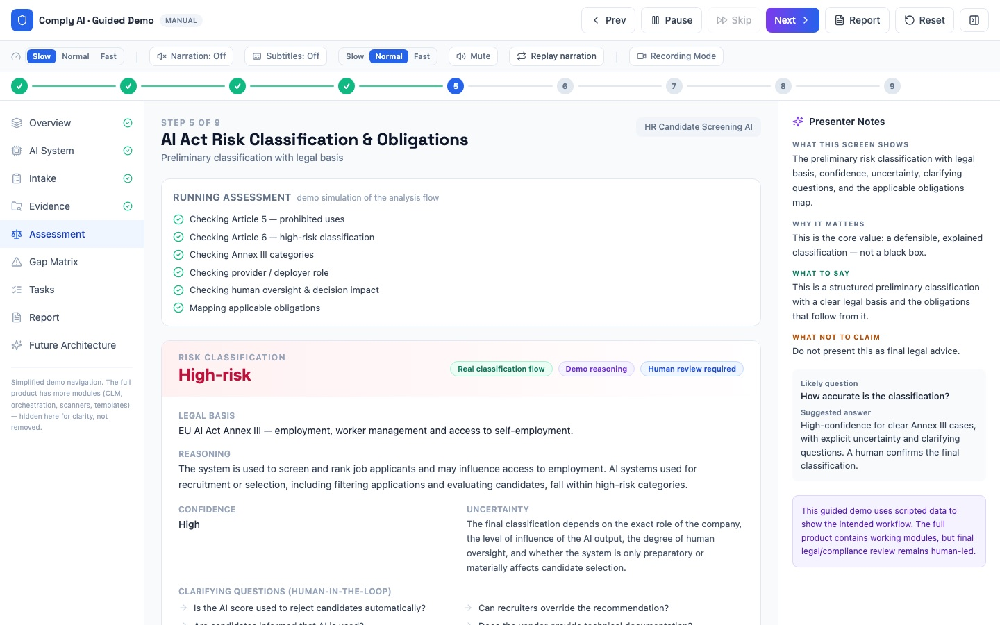
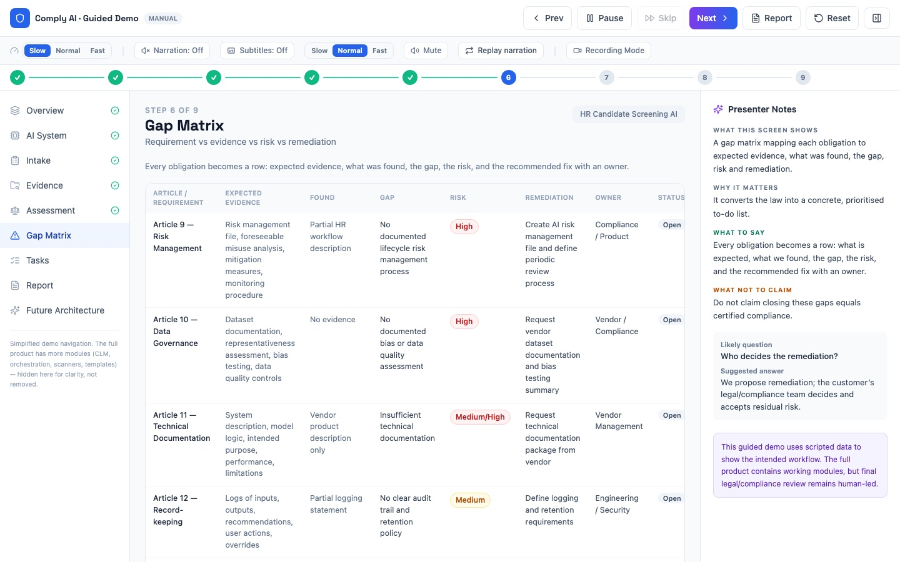
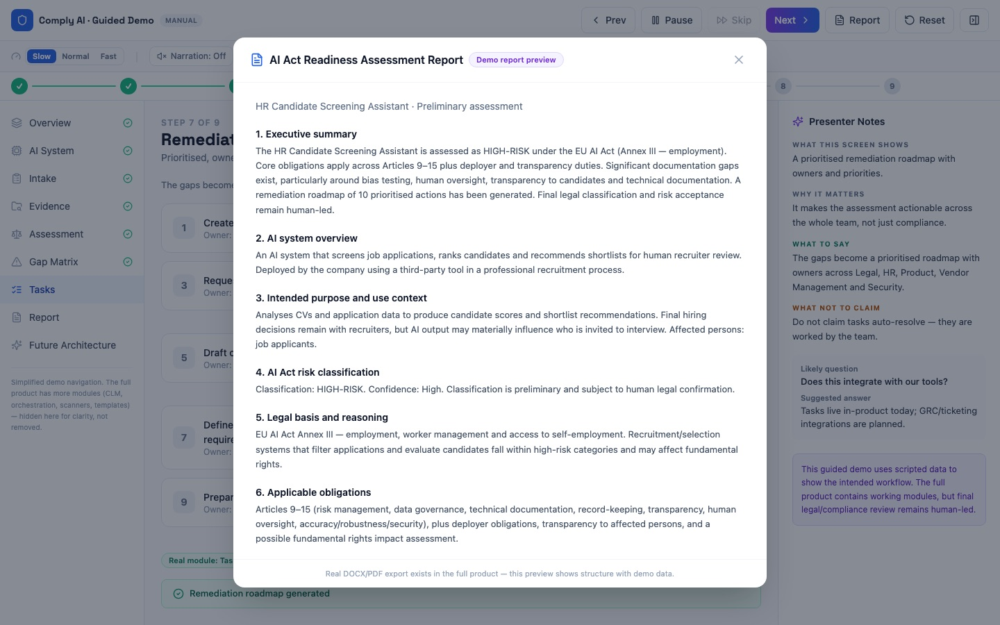

# Comply AI

**EU AI Act readiness, one AI system at a time.**

Comply AI takes an AI system a company uses and turns it into a risk classification with legal basis, an obligations map, an evidence gap matrix, owned remediation tasks and a management-ready report.

**▶ Live demo:** https://cybermaga.github.io/comply-ai/demo/
**Project page:** https://cybermaga.github.io/comply-ai/
**Product site:** https://comply-ai-demo.vercel.app



## The problem

The EU AI Act (Regulation (EU) 2024/1689) is in force, with fines up to €35M or 7% of worldwide turnover. Most companies have no inventory of their AI systems, cannot tell which ones fall under Annex III as high-risk, and do not know what evidence the law expects. That first pass is usually done by hand and takes weeks. Comply AI does it in minutes and leaves the final legal call to a human reviewer.

## Workflow

1. **Register the system**: purpose, users, data, deployment context
2. **Structured intake**: vague descriptions become legally relevant answers
3. **Collect evidence**: what exists and what is missing
4. **Classify the risk**: prohibited / high / limited / minimal, with reasoning
5. **Gap matrix**: requirement → evidence → gap → risk → fix
6. **Remediation tasks**: prioritised, with owners
7. **Report**: exported to DOCX / PDF

| Gap matrix | Remediation report |
|---|---|
|  |  |

## Worked example

An HR CV-screening and ranking tool used by an employer is classified **high-risk** under Art. 6(2) and Annex III, point 4(a) (recruitment and selection). Comply AI maps the Art. 9–15 requirements and Art. 26 deployer duties, finds the missing evidence (risk management, bias testing, vendor technical documentation, worker notice) and produces 10 prioritised remediation tasks plus a readiness report.

## How it is built

| Layer | Technology |
|---|---|
| Frontend | React, Vite, Tailwind CSS, Recharts |
| Backend | Python, FastAPI (~20 domain routers) |
| Data | MongoDB |
| AI layer | Mistral LLM for reasoning and report drafting |
| Documents | DOCX / PDF export |
| Delivery | Web app, Electron desktop build, Docker Compose |

The full product is about 54k lines of code. **Its source is private.** This repository contains the public guided demo and the project page.

## What is real today

| Capability | Status |
|---|---|
| Web workflow, intake, classification, evidence and gap mapping, tasks | ✅ Working |
| LLM reasoning (Mistral), DOCX/PDF export | ✅ Working |
| Document extraction, read-only GitHub connector | 🟡 Partial |
| Public API, SDK, GRC integrations, CI/CD checks | ⚪ Planned |
| Final legal classification and risk acceptance | 👤 Always human |

## This repository

```
demo/   React + Vite source of the guided demo (scripted data, no backend)
docs/   GitHub Pages site: project page + built demo
```

Run the demo locally:

```bash
cd demo
npm install
npm run dev        # http://localhost:5173
npm run build      # writes to ../docs/demo
```

## My role

Founder. I defined the product and its go-to-market, translated AI Act requirements into data models and screens, and built the application end to end with AI-assisted development.

---

*Comply AI is a readiness tool. It does not give legal advice or certify compliance. The demo uses scripted data.*
